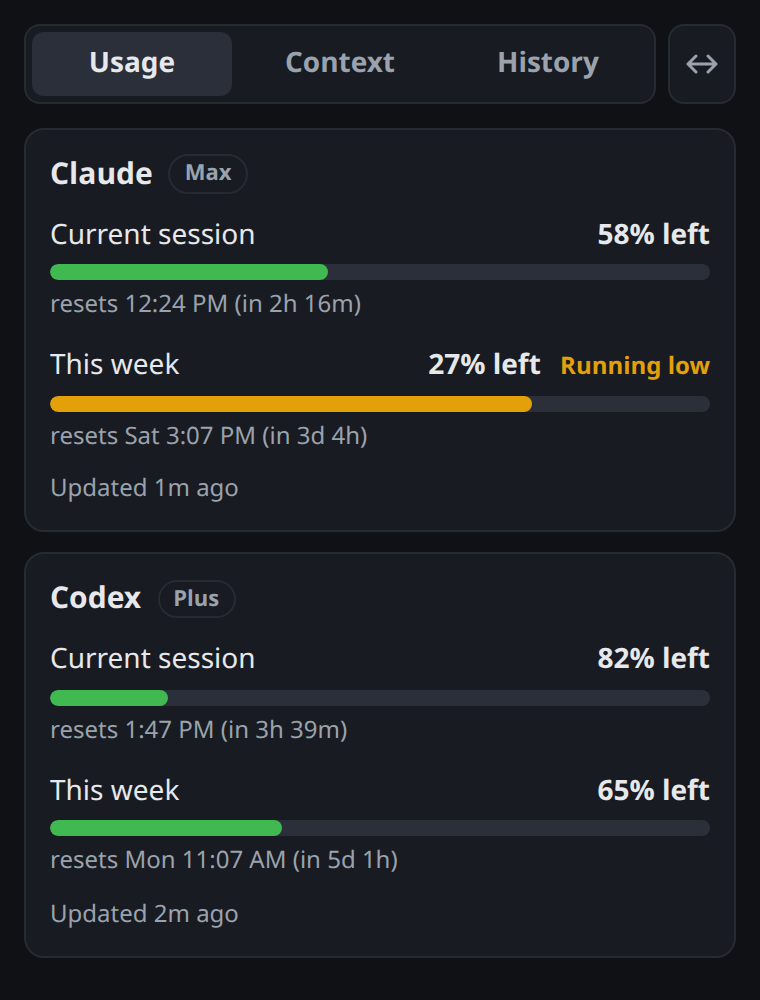
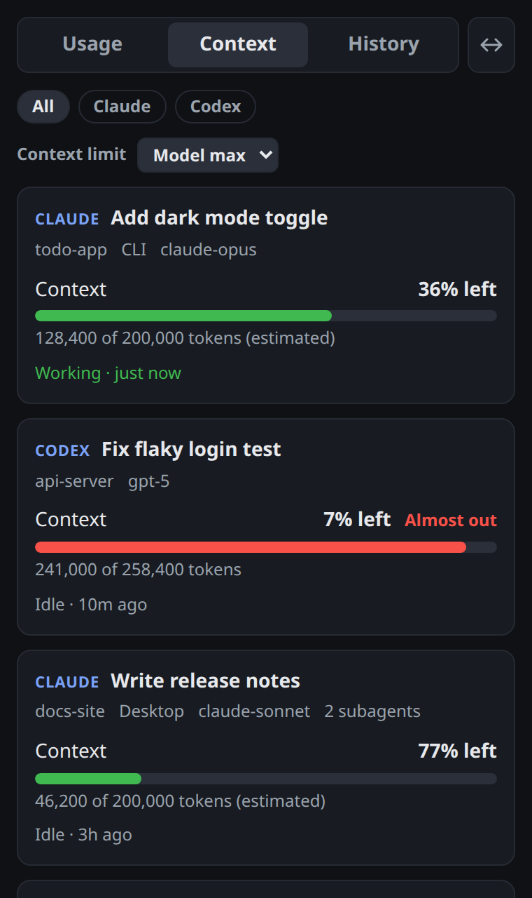
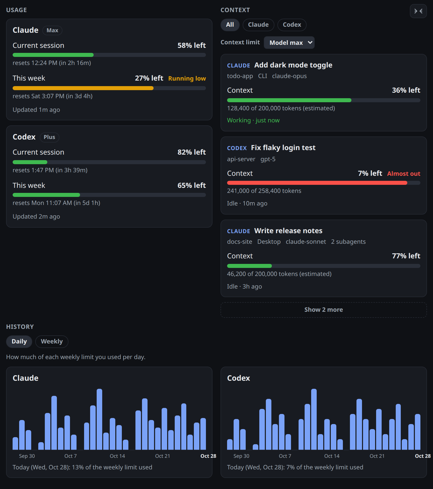

# Agent Context Monitor

A small desktop app that lives in your tray and shows how much Claude Code and Codex usage you have left, plus how full the context is in each of your recent chats. It reads what's already on your computer and never stores your messages.

<p align="center">
  
  &nbsp;&nbsp;
  
</p>

## Install

On macOS or Linux, run this in a terminal:

```bash
curl -fsSL https://raw.githubusercontent.com/bradtraversy/agent-context-monitor/main/install.sh | sh
```

On Windows, run this in PowerShell:

```powershell
irm https://raw.githubusercontent.com/bradtraversy/agent-context-monitor/main/install.ps1 | iex
```

Both download the latest release for your system and install it. Run the same command again to update. On Linux it uses the `.deb` or `.rpm` when your system has apt or dnf, otherwise the AppImage in `~/.local/bin`.

Or download the installer yourself from the [latest release](https://github.com/bradtraversy/agent-context-monitor/releases/latest).

- macOS: the `.dmg`. Works on Apple Silicon and Intel, macOS 11 or later.
- Windows: the `-setup.exe` or the `.msi`. If Windows shows "Windows protected your PC", click More info, then Run anyway.
- Linux: the `.deb` (Ubuntu, Debian), the `.rpm` (Fedora), or the `.AppImage` (any distro, make it executable and run it).

You need Claude Code, Codex, or both installed and logged in. The app picks them up on its own, there's nothing to set up.

## What it shows

- Usage: how much of your current session and weekly limit is left for Claude and Codex, and when each one resets.
- Context: every Claude and Codex chat you used in the last 24 hours, with how much of its context window is left. Filter by provider, or set your own context limit (say 300K) to measure chats against.
- History: daily and weekly bars of how much of your weekly limit you used.

Widen the window, or click the arrow button in the top corner, to see everything side by side.



The tray dot turns amber at 70% used and red at 90%, and you get a desktop alert when a limit or an active chat is close to running out. Closing the window keeps the app in the tray. Turn on Start at login from the tray menu.

On Linux, use the tray menu to open the window or quit. GNOME needs the AppIndicator extension, which Ubuntu ships with.

## Privacy

Everything runs on your computer, read-only. The app reads chat metadata (title, model, token counts) from Claude Code and Codex's local files, never message content. The only network calls are the usage checks: one request to Anthropic every few minutes using the login Claude Code already saved, and Codex's own usage check through the installed Codex. Your login token is never logged or stored by the app. For the History tab it keeps a small log of usage percentages in its data folder, trimmed to 120 days.

<details>
<summary>Where the data comes from</summary>

- Claude usage: the login Claude Code saves in `~/.claude/.credentials.json` (or `$CLAUDE_CONFIG_DIR`), or the Keychain on macOS, used for one read-only usage request every four minutes. If the login is missing or expired, Claude usage shows as unknown.
- Codex usage: the installed Codex's read-only rate limit check (`codex app-server`), the same source as its /status screen, plus the newest `token_count` record in `~/.codex/sessions` (or `$CODEX_HOME/sessions`). Whichever is newer wins. The app finds Codex on the PATH, in the usual install folders, and in the Codex desktop app.
- Claude chats: open chats from `~/.claude/sessions`, recent ones from transcripts in `~/.claude/projects`, and the Claude desktop app's own chat list so reopened and archived chats are handled the way the app shows them. Claude transcripts don't record the context window, so it's estimated from the model (1M for `[1m]` models or chats already past 200K, otherwise 200K) and marked estimated.
- Codex chats: `~/.codex/sessions`, titled from `session_index.jsonl`.

Readings older than five minutes are greyed out and marked as possibly out of date, and they don't color the tray.

</details>

## Roadmap

1. A "runs out at" estimate for session and weekly usage
2. Usage broken down by project
3. Click a chat to open its folder or copy its resume command
4. More providers, such as Gemini CLI, Cursor, and Copilot
5. A keyboard shortcut to open the window

## Develop

Requires Rust, Node, and the [Tauri prerequisites](https://tauri.app/start/prerequisites/).

```bash
npm install
npm run tauri dev
```

Run the tests with `cargo test --manifest-path src-tauri/Cargo.toml` and build installers with `npm run tauri build`. Release steps are in [docs/RELEASING.md](docs/RELEASING.md).

## License

MIT
